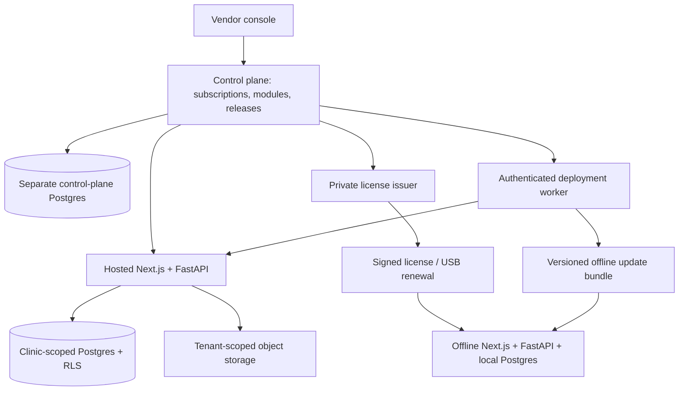

# Multi-clinic SaaS and offline distribution plan

Date: 2026-10-18. Status: SaaS controls deployed and live acceptance passed (0.1.1-saas.20261018).

Confirmed scope: vendor-operated hosted SaaS **and** offline clinic installations;
monthly subscriptions, vendor-controlled releases and suspension, clinic branding,
and independently sold modules. One codebase; no clinic-specific forks.

## Product decisions

- Vendor owns platform operations, module grants, subscriptions, signing keys, and
  releases. Clinic administrators manage their own staff and clinic settings only.
- Each clinic gets its own identity, branding, data scope, and module allocation.
  Branding does not confer platform ownership. Patient data stays exportable.
- Hosted is the standard product. Offline is a separately provisioned installation
  of the same product, using signed licenses and the same module identifiers.
- Suspension locks ordinary operational writes. Authenticated record viewing,
  audit, export, backup, renewal, and support remain available with existing RBAC.
  Disabling login through `Hospital.is_active` is not the subscription mechanism.
- Offline licenses cannot receive an immediate remote suspension without a
  connection. Enforce the signed expiry locally; accept revocation on reconnect.
  Local administrator control also prevents promising tamper-proof enforcement.
- Monthly means calendar billing periods in Africa/Addis_Ababa, persisted as UTC
  instants. Never approximate a month as 30 days. Default currency: ETB.

## What already exists, and what does not

| Area           | Repository evidence                                                           | Remaining work                                                                |
| -------------- | ----------------------------------------------------------------------------- | ----------------------------------------------------------------------------- |
| Tenancy        | Prisma `Hospital` and SQLAlchemy `Hospital`; scoped patient workflows         | Prove every route, relation, file, job, cache, and aggregate is isolated      |
| Backend        | `docs/adr/0001-python-postgres-erp-boundaries.md` chooses FastAPI/Postgres    | Finish migration; Next route handlers and MySQL remain active                 |
| Vendor console | `/owner`, platform inventory, authenticated worker queue                      | Move vendor workflows to FastAPI/Postgres; add subscription/module controls   |
| Deployment     | Worker provisions separate Compose projects and deploys versions              | Digest allowlist, backend release images, migration/rollback safety           |
| Licensing      | Ed25519 verification, installation binding, replay/time evidence, USB renewal | Connect explicit module grants, tenant binding, payment-to-renewal workflow   |
| Feature grants | Installation JSON and handwriting environment flag                            | Runtime, server-enforced module catalog across every entry point              |
| Branding       | Clinic name/logo fields                                                       | Remove hardcoded Lemlem/Sunny Smile fallbacks throughout app/print/email      |
| Billing        | Clinic plans/subscription fields, patient billing                             | Separate vendor subscription ledger, payment reconciliation, grace/suspension |

`next.config.js` currently has no FastAPI rewrites. The worker Dental ERP template
still provisions MySQL, and its generated environment disables licensing. Neither
existing feature JSON nor license expiry inventory currently proves SaaS enforcement.

## Target topology

Shared hosted app/database is the default target, with tenant scopes and Postgres
row-level security as defense in depth. Dedicated clinic stacks remain an option
for stronger isolation or separately scheduled versions; reuse the existing worker.
Vendor control plane has no automatic access to clinical databases. Cross-clinic
support access requires a distinct, time-limited, audited workflow.

Hosted subdomain resolves a verified clinic identity; authenticated membership must
match it. Reject arbitrary Host/X-Forwarded-Host and client-supplied tenant IDs.
Use exact registered domain mappings, trusted proxy configuration, and host-only
cookies. Offline installation is bound to exactly one clinic by default.

Independent offline and hosted databases do **not** imply clinical data sync.
Offline clinics run locally. Bidirectional sync/conflict resolution is separate
scope; the first release transfers only entitlement and operational metadata.

## Module catalog and packages

Commercial modules are entitlements; RBAC remains a separate requirement:

`allow = authenticated membership AND permission AND module grant AND subscription policy`

Core identity, settings, audit, renewal, export, and recovery are always included.
Ordinary module dependencies must already be granted; requesting an add-on must
never silently unlock another paid module.

| Module ID        | Covers                                                                  | Requires                                                    |
| ---------------- | ----------------------------------------------------------------------- | ----------------------------------------------------------- |
| `core`           | Identity, clinic settings, access status, audit, recovery               | —                                                           |
| `patients`       | Registration, demographics, patient documents/history                   | core                                                        |
| `appointments`   | Scheduling, queue, waitlist                                             | patients                                                    |
| `clinical`       | Encounters, charting, treatment, prescriptions, drug/procedure catalogs | patients                                                    |
| `billing`        | Patient invoices, receipts, payments, payment plans                     | patients                                                    |
| `insurance`      | Providers, policies, pre-authorizations, claims                         | billing                                                     |
| `lab`            | Vendors, lab cases, delivery workflow                                   | clinical                                                    |
| `finance`        | Expenses, ledger, commissions, cash flow                                | billing                                                     |
| `inventory`      | Stock, purchases, suppliers                                             | core                                                        |
| `staff`          | HR, attendance, leave, shifts                                           | core                                                        |
| `reports`        | Advanced analytics and report exports                                   | core; each report also needs its source modules             |
| `crm`            | Memberships, loyalty, referrals, segments                               | patients                                                    |
| `communications` | SMS/email, reminders, feedback, automations                             | patients                                                    |
| `forms`          | Templates, consent, certificates                                        | patients                                                    |
| `portal`         | Patient portal                                                          | patients                                                    |
| `video`          | Remote consultations                                                    | appointments, clinical                                      |
| `ai`             | AI helpers                                                              | core; each tool also needs its source module and permission |
| `sterilization`  | Instruments, cycles, compliance                                         | core                                                        |
| `devices`        | Device integrations                                                     | core                                                        |
| `data_import`    | Bulk imports                                                            | core; each importer also needs its destination module       |

Starter proposal: core + patients + appointments + clinical. Practice: Starter +
billing. Operations: Practice + lab + finance + inventory + staff + reports.
Other modules are explicit add-ons. These are editable package templates, not
hardcoded authorization tiers. Prices, limits, trial duration, and discounts remain
commercial decisions; do not invent prices or promise payment-provider integration.

Handwritten diagnosis becomes an explicit capability within clinical. Existing
`handwrittenDiagnosis` flags require a migration mapping; no wildcard grants.

Each catalog entry will own routes/pages, permissions, dependencies, navigation,
jobs, report sources, and compatible release range. Start as a modular monolith;
independent pricing does not require separate microservices.

## Subscription and lock behavior

| State                                     | Ordinary module reads       | Ordinary writes                       | Recovery  |
| ----------------------------------------- | --------------------------- | ------------------------------------- | --------- |
| Trial / active, before access deadline    | Enabled modules             | Enabled modules                       | Available |
| Grace                                     | Enabled modules             | Enabled modules; warning shown        | Available |
| Expired / canceled                        | Last entitled modules       | Locked                                | Available |
| Vendor suspension                         | Last entitled modules       | Locked immediately on hosted requests | Available |
| Missing/invalid policy or offline license | Recovery record viewer only | Locked                                | Available |

Hosted deadline and grace endpoint are persisted, explicit instants. Access stops
at the endpoint (`now >= grace_until`). Cancellation can be scheduled for period
end; convert to canceled only when effective. Standard offline grace remains the
existing five calendar days; do not silently change the signed v1 contract.

Hosted decisions read current trusted policy on every request initially, including
already logged-in sessions. Later caching requires explicit revision invalidation
and a documented maximum suspension latency. Do not store authoritative grants
only in JWTs. Worker jobs recheck tenant policy before execution.

Vendor payments are distinct from patient payments. First support manual bank/
Telebirr receipt verification in the vendor console: record amount, reference,
verified-by, timestamps, and paid-through period. Renewal and license issuance must
be transactional/idempotent. Automated payment webhooks come later with signature
verification, duplicate/reordering handling, and reconciliation; clinic UI never
marks its own subscription paid.

Downgrades default to next billing period. Preview dependencies, affected workflows,
and limits before application. Preserve records; offer authenticated read/export
through recovery when a module is removed. Never delete data on downgrade.

## Persistence and trust model

Control plane: Customer, Tenant, Installation, verified Domain, BrandingProfile,
ModuleDefinition, PackageVersion, Subscription, SubscriptionPeriod, ModuleGrant,
SubscriptionPayment, PolicyRevision, Release, Deployment, LicenseIssuance, and
append-oriented PlatformAuditEvent. Subscription prices use fixed decimals.

Data plane: existing clinic records plus verified policy revision and clinic
branding. All patient/business rows, storage keys, exports, background jobs,
websocket channels, rate limits, and caches carry tenant scope. Cross-tenant foreign
key references must fail through scoped lookups and composite constraints where
applicable. RLS uses a non-owner, non-BYPASSRLS application role and transaction-local
tenant context; test with real Postgres and pooled connections.

Global identities plus tenant memberships replace the current assumption that one
globally unique email belongs to only one clinic. Clinic roles cannot grant vendor
privileges. Tenant switching revalidates membership server-side.

Offline issuer signs explicit `module:<id>` entitlements using the existing v1
envelope, sequence, product, customer, installation, and expiry fields. Bind vendor
customer ID to local clinic through installation registration; the current runtime
summary alone does not expose customer identity, so use the verified payload.
The existing bare `core` grant is never interpreted as every module. An audited
migration issues explicit grants before strict module enforcement is enabled.

Keep issuer keys vendor-side. Online entitlement transport is authenticated and
bound to tenant/installation/revision. Signed policy or license import cannot be
replaced by writable environment flags. Offline revocation reaches a disconnected
installation only on license expiry or delivery of a newer signed policy.

## Branding and distribution

Brand profile: display/legal names, English/Amharic name, logo/favicon, validated
color tokens, contacts, address, invoice/receipt header, and email/SMS sender display
name. Render consistently on login, navigation, public booking, portal, forms,
prescriptions, print/PDF, and notifications. No arbitrary injected CSS/HTML/JS.
Validate uploads, URLs, ownership, and tenant-scoped asset keys. Domain verification
precedes custom-host routing and certificate activation.

Cloud delivery is a clinic URL, not a source-code fork. Offline delivery is a
versioned installer/update bundle plus installation-bound signed license. Software
ownership/subscription terms and existing repository notices need separate product
review; branding alone is not ownership enforcement.

## Releases

One release manifest pins frontend image digest, backend image digest, schema
compatibility, module catalog version, and offline bundle checksums. Registry
publishing alone never triggers customer deployment. Vendor chooses canary,
scheduled, or stable rollout and observes health before promotion.

Shared hosted tenants run the same application version. Per-clinic variation uses
entitlements and rollout flags. Separate version pinning needs a dedicated stack;
do not claim arbitrary per-clinic binary versions inside a shared process.

Use expand/contract database migrations, pre-update backups, tested restore, and
rollback-compatible manifests. Failed health checks stop rollout. Changing an app
image is not sufficient rollback for destructive schema changes. Offline updates
need local backup, signature/checksum verification, preflight, migration, health
check, and explicit recovery instructions. Existing worker version strings must
be replaced by vendor-approved immutable release references.

## Delivery sequence and acceptance gates

1. **Commercial policy foundation.** Catalog, dependency validation, hosted access
   decisions, verified offline entitlement interpretation, and interface tests.
   First implementation accompanies this plan; not connected to production routes.
2. **Tenant/platform persistence.** Alembic schema, membership/registration mapping,
   vendor-only mutations, audit, policy revisions, and two-clinic fixtures. Acceptance:
   clinic admins cannot read/write vendor state; tenant IDs cannot select another clinic.
3. **Backend cutover and enforcement.** Inventory all Next/FastAPI/public/mobile
   routes and jobs; wire one policy seam after auth/RBAC. Cut over vertical slices
   to FastAPI and remove corresponding Prisma handlers. Compose must include backend
   and Postgres. Missing configuration denies access on new SaaS installations.
   Acceptance: direct calls, active sessions, worker jobs, nested routes, exports,
   dashboard summaries, and reports cannot bypass module or tenant scope. Aggregate
   payloads omit unlicensed module data before querying/serialization.
4. **Branding and clinic experience.** Bootstrap authenticated tenant profile,
   capabilities, navigation, lock/grace banners, recovery viewer, renewal contact,
   and all print/public surfaces. Acceptance: two clinics show distinct branding;
   changing host/client state cannot switch authenticated tenant access.
5. **Vendor subscriptions/modules.** Owner console provisions clinics, assigns
   packages/add-ons, records monthly payments, schedules downgrades, suspends and
   restores. Acceptance: grant/revoke takes effect without redeployment; repeated
   renewal requests do not create extra periods, payments, or license sequences.
6. **Offline commercial rollout.** Issuer writes explicit module grants; installer
   enables required enforcement; USB renewals, reconnect revocations, backup, rehost,
   and update bundles. Acceptance: airplane-mode expiry/grace, wrong installation/
   customer, altered signatures, clock rollback, old sequence, and emergency renewal
   follow documented rules; clinical recovery stays usable.
7. **Release operations and pilot.** Backend image CI, manifest allowlist, canary,
   staged promotion, rollback/restore drill, monitoring, and signed offline updates.
   Pilot with two differently branded/granted hosted clinics plus one disconnected
   installation. Acceptance: no data crossover, lock/unlock works, module bypasses
   fail, restore succeeds, and vendor explicitly promotes every release.

## Delivered implementation

Commercial policy, dependency-validated module catalog, separate Postgres control
storage, vendor-only APIs/UI, manual payment ledger, calendar-month renewals,
suspension/restoration, scheduled module grants, audit, signed offline issuance,
hosted API/job enforcement, recovery viewer, modular navigation/home, clinic
branding, installer identity configuration, immutable worker release allowlist,
manual promotion, backups/restore checks and rollback are implemented.

Existing Lemlem receives explicit indefinite migration access until owner records
its first paid term. No automatic charge or expiry was invented. No commits made;
existing user `AGENTS.md` changes and `output/` artifacts remain untouched.

This release uses a compatibility adapter around active Next/MySQL clinical routes.
It adds an isolated FastAPI/Postgres commercial control companion. It does not
finish the larger clinical FastAPI/Postgres/RLS migration, global memberships,
automated payment reconciliation, automated custom-domain verification, clinical
sync, or a Windows hardware acceptance run. Dedicated clinic installations remain
the production isolation and independent-version delivery mechanism.

Operational handover and limitations: [SAAS_OPERATIONS.md](SAAS_OPERATIONS.md).

## Production acceptance — 2026-10-18

Release `0.1.1-saas.20261018` deployed to clinic and vendor web services.
4,615 frontend tests, 121 backend tests, four worker tests passed; two Windows-only
checks skipped on macOS. TypeScript, changed-source lint, production build and
real Postgres migrations passed.

Live synthetic-clinic checks passed for active writes, module denial, cross-clinic
patient denial, vendor separation, concurrent renewal idempotence, suspension,
read/recovery, restoration and revocation. Synthetic fixtures removed. Lemlem
retains all 20 modules in explicit migration status with no expiry.

Actual vendor owner screen/admin bridge, clinic access/branding, issuer signature,
shipped public trust anchor and installation binding passed. Clinic/vendor MySQL
backups and commercial Postgres backup restored into isolated scratch databases.
Protected deployment/acceptance records remain on VPS under `/opt/dental-saas/`.

Windows hardware/LAN acceptance, automatic reconnect revocation and the larger
clinical Postgres/RLS migration remain outside this delivered compatibility rollout.
Offline installs enforce locally imported signed license expiry/grace; they do not
poll vendor for immediate suspension in this release.
